# What's new

## 0.9.0 (15 Nov 2026)

**A list becomes a mind map, and back.** Copy a bullet list from any note. In a drawing, press leader, N, V. Each item becomes a box, joined to the item it sits under. Leader, N, Y copies a map as a list. Leader, N, I puts the list in a note.

**Edit a map like an outline.** Select a box. Alt+Up and Alt+Down move it among its siblings. Alt+Left moves it up a level. Alt+Right moves it under the box above. The map tidies itself after each move.

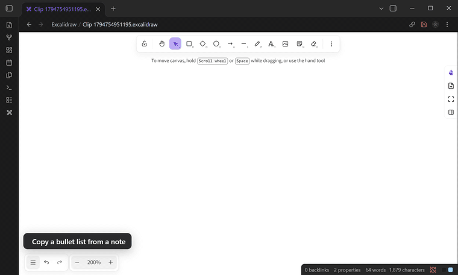

**Arrows go around boxes.** When a box sits between two shapes, a new arrow goes under or over it, not through it.

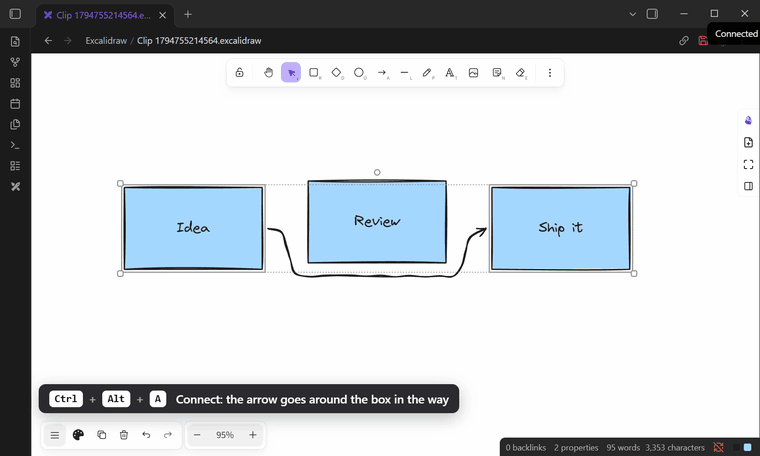

**One look for the whole drawing.** Leader, K, L. Pick one of five looks. All boxes, lines and text change in one step. One Ctrl+Z undoes it.

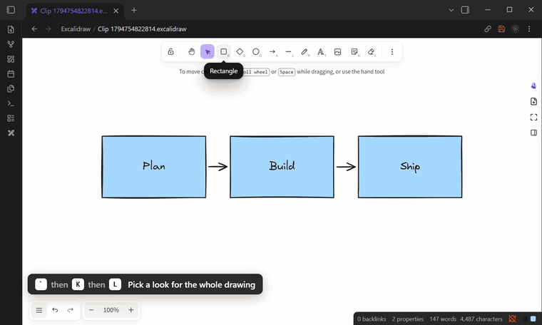

**Also new**

- **Fold all** (leader, N, Z) and **open all** (leader, N, O) for a whole mind map.
- **Label an arrow**: select it, then leader, R, L. You type the label at once.
- **Export everything** and **Import everything** in Settings, Share. One file holds all your settings, keys, presets and stamps. Use it to move to a new computer.
- **Lighter on your computer.** The plugin does almost no work when no drawing is open or Obsidian is in the background. Big drawings (1,500 shapes) stay fast.

## 0.8.1 (15 Nov 2026)

- Folding one box now says "Folded 1 box", not "1 boxes".

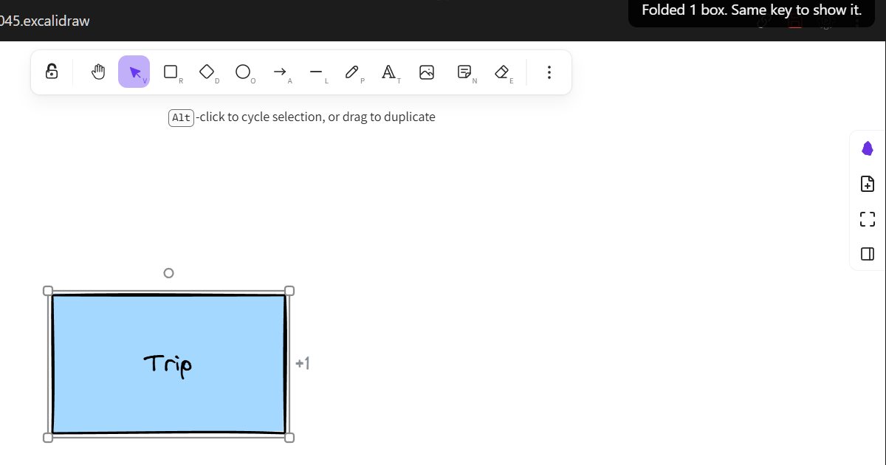

## 0.8.0 (15 Nov 2026)

**Tidy and fold a mind map.** Leader, N, T spaces out the whole map so no branch overlaps another. Leader, N, F hides the boxes under a box and shows a +3. The same key shows them again.

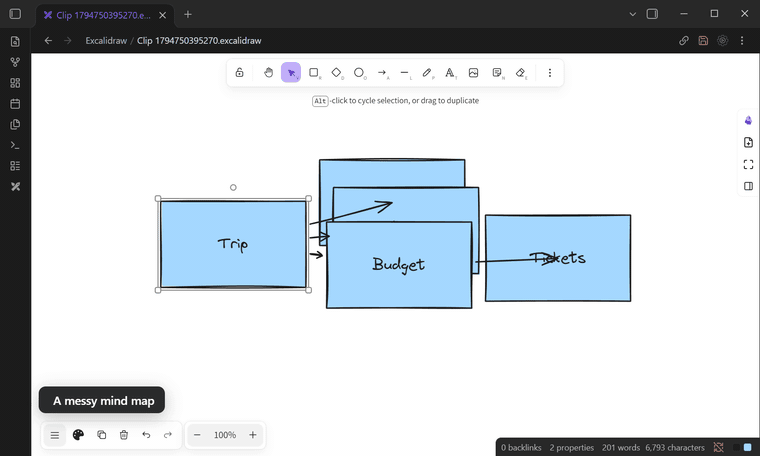

**Layouts.** Select some shapes, then leader, L, L. Pick a flowchart, timeline, kanban board or 2×2 grid.

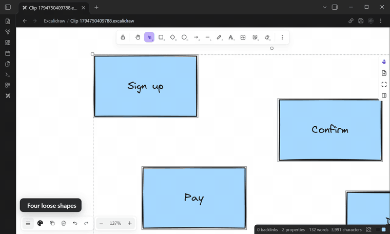

**Arrows follow a mouse drag.** Drag a shape, and the arrows this plugin laid are drawn again from the sides that now face each other. One Ctrl+Z still undoes the drag.

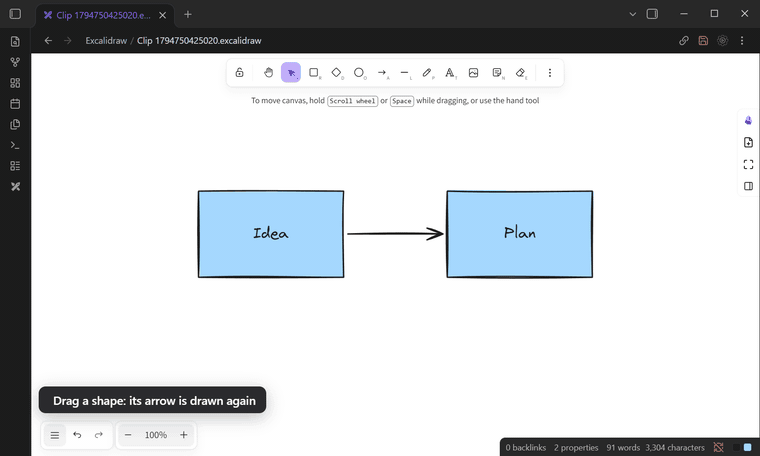

**Learn the keys as you go.** Click a toolbar or style button that has a key, and a short note shows the key. Three times for each, then it stops.

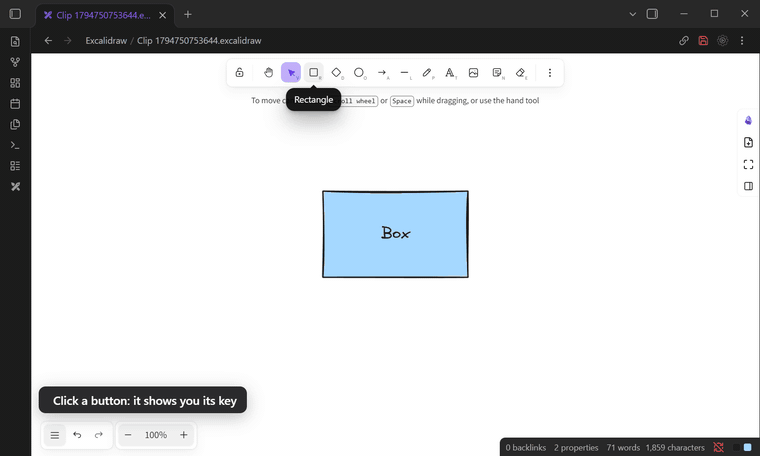

**Practice.** Run **Practice the keys** for a two-minute lesson in a new drawing. Each step checks itself.

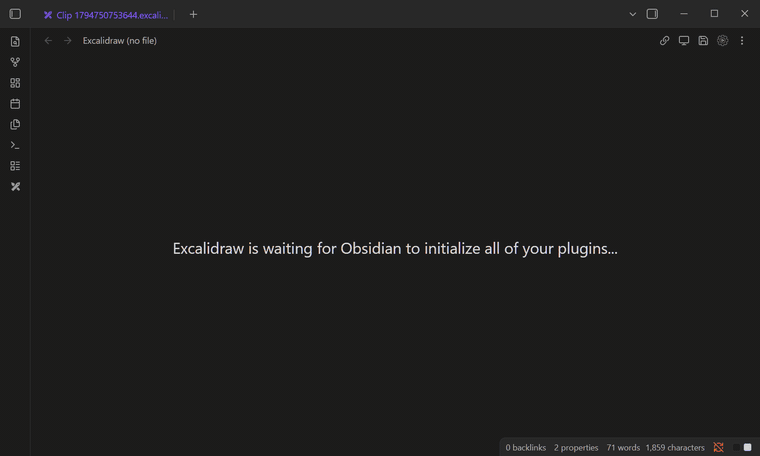

**Phones and tablets.** One ⚡ button in the drawing's top row has every action, with the same names as the leader menu. It repeats nothing that Excalidraw's own bar has, and it takes no room from the drawing. Without a keyboard, the plugin keeps to a light version: 23 commands and a short settings page. Turn on **I use a keyboard on this device** to get everything on that device.

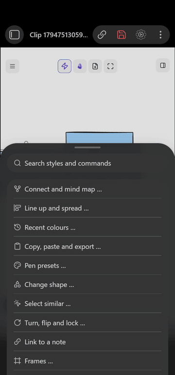

**Also new**

- **Copy as an image**: leader, Y, I. **Put in a note**: leader, Y, N saves a PNG and adds it to the end of a note.
- **Key sets**: the first-start popup and Settings, Keys can give keys to only the basics, or to the leader key only.
- **What's new**: after an update, this list opens in a tab. Turn it off in Settings, Keys.
- Release notes on GitHub show the same list, with pictures.

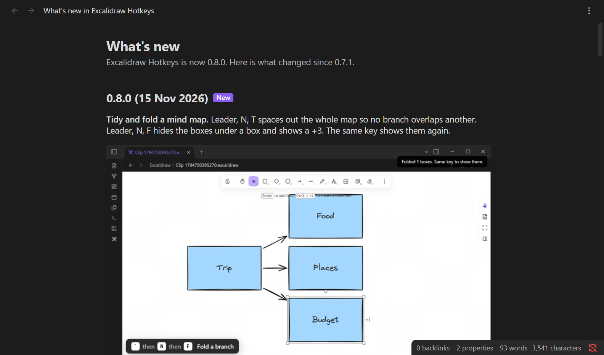

## 0.7.1 (14 Nov 2026)

- **Use suggested keys** skips any key that another command already uses. Your own keys stay yours.

## 0.7.0 (14 Nov 2026)

- **Mind map.** Tab adds a child, Shift+Tab adds a sibling. The new box gets an arrow and opens for typing.
- **Line up and spread** knows about text. A loose label next to a shape moves with that shape. A frame moves with everything in it.
- **Smooth moves.** Line up, spread, swap, grid and same size glide into place. Fast key presses never get lost.
- **Arrows look hand-placed.** They leave from the sides that face each other, with a soft curve. New setting **Arrow style**: curved, straight, elbow, or the same as the pen.
- **New keys:** sketchiness, round or sharp corners, arrow shape, change shape, connect two shapes, copy and paste a style, select similar, same size, tidy grid, swap, rotate, flip, lock and unlock, link to a note, wrap in a frame, next and previous frame.
- **Stamps.** Save a group of shapes and drop it again with one key.
- **Macros.** Record a few steps and play them back with one key.
- **Recent colours** on the bar and in the leader menu.
- **Your own buttons** on the preset bar.
- **Share presets.** Export them to a file and import them in another vault.
- **Hex colours** in search: type `#e03131`.
- The preset bar sits in Excalidraw's own bottom row.
- **Guide.** Opens after the first-start popup. Also: leader key, then `?`.

## 0.6.1 (14 Nov 2026)

- New demo GIF. Search understands short forms. Clearer preset names.

## 0.6.0 (14 Nov 2026)

- **Repeat key** does your last change again on a new selection.
- **Line up and spread** in the leader menu.
- Change the leader menu in Settings, and add any command to it.
- **Preset bar** at the bottom of the drawing.

## 0.5.0 (14 Nov 2026)

- First-start popup with suggested keys.
- **Key panel** shows what each key does while you hold it.
- **Pen presets**, the **leader key**, move between shapes with Shift+WASD, and smart search.

## 0.4.0 (14 Nov 2026)

- Tool letters work only inside a drawing, so they never block typing in notes.
- Tool keys take any key or combo.

## 0.3.0 (14 Nov 2026)

- One-hand keys. Colour keys change the selection, or the pen when nothing is selected.
- Shift goes back on cycle keys. Settings on their own pages.

## 0.2.0 (14 Nov 2026)

- First public version: colour, width, style, duplicate and zoom keys, and the hotkey list.
