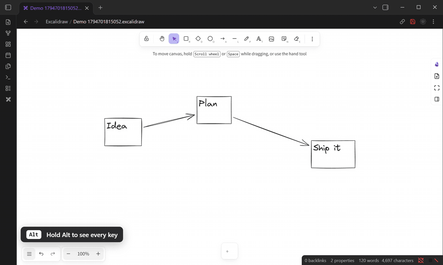

# Excalidraw Hotkeys

Keyboard control for [Excalidraw](https://github.com/zsviczian/obsidian-excalidraw-plugin) drawings in Obsidian. Colour, fill, line style, fonts, resize, duplicate with an arrow, and smooth zoom presets.



Every action is an Obsidian command. You choose the keys in **Settings → Hotkeys**, like any other command. Each command also works from a vimrc (`exmap` + `obcommand excalidraw-hotkeys:<id>`).

## Start

1. Install and turn on the plugin. It needs the Excalidraw plugin.
2. Open **Settings → Excalidraw Hotkeys**.
3. Press **Use suggested keys**. This gives every command without a key the key in the table below. Keys you already set stay as they are.

Run **Show my hotkeys** at any time to see your keys. Press **Save as note** in that window to write the list to a note.

## Commands

| Command | Suggested key |
|---|---|
| **Colour** | |
| Stroke colour 1–8 (lines, arrows, text, text in a box) | `Alt+Shift+1` … `Alt+Shift+8` |
| Fill colour 1–8 (text gets the stroke colour) | `Alt+1` … `Alt+8` |
| Cycle fill style (hachure, cross-hatch, solid, none) | `Alt+F` |
| Reset to black with no fill | ``Ctrl+` `` |
| More see-through / More opaque | `Alt+-` / `Alt+=` |
| **Lines** | |
| Cycle line style (solid, dashed, dotted) | `Alt+D` |
| Line style solid / dashed / dotted | none |
| Cycle line width (thin, bold, extra bold) | `Alt+W` |
| Line width thin / bold / extra bold | none |
| Turn start / end arrowhead on or off | `Alt+[` / `Alt+]` |
| **Text** | |
| Align text left / centre / right | `Ctrl+Shift+L` / `;` / `'` |
| Cycle font (hand-drawn, normal, code) | `Alt+T` |
| Font hand-drawn / normal / code | none |
| Font size small / medium / large / very large | none |
| Font size up / down | none |
| Fit box to text | `Ctrl+/` |
| **Duplicate** | |
| Duplicate up / down / left / right with an arrow | `Ctrl+Arrow` |
| **Size** | |
| Grow / shrink width | `Shift+.` / `Shift+,` |
| Grow / shrink height | `Alt+.` / `Alt+,` |
| Grow / shrink size or line width | `Ctrl+Shift+.` / `Ctrl+Shift+,` |
| **Zoom** | |
| Zoom preset 1–9 | `Ctrl+Alt+1` … `Ctrl+Alt+5` |
| Zoom in / out to the next preset | `Ctrl+Alt+=` / `Ctrl+Alt+-` |
| **Other** | |
| Show my hotkeys | none |

With nothing selected, the stroke and fill keys set the colour for the next thing you draw or write. While you type a text, the stroke keys change the colour of that text. Each colour key shows a short popup with the new colour. The status bar at the bottom right shows the stroke and fill colour while a drawing is open.

Hold two arrow keys to move the selection on a diagonal. Hold Shift too for a bigger step. This one is not in the Hotkeys menu.

## Settings

- **Zoom presets**: type the percents, for example `25, 50, 100, 200, 400`. Preset 1 is the first number.
- **Zoom speed**: how long one zoom takes. 0 is instant.
- **Zoom on the selection**: with something selected, the zoom moves to it.
- **Colours**: the 8 fill colours and the 8 stroke colours.
- **Copy keeps text** and **Copy keeps fill**: what a duplicate takes from its box.
- **Colours in the status bar**: show the stroke and fill colour at the bottom right.
- **Catch keys before Excalidraw**: keep this on. Excalidraw uses some of these keys for its own functions.

Every edit is one undo step. `Ctrl+Z` undoes a duplicate with its arrow in one press.

## Install by hand

Download `main.js`, `manifest.json` and `styles.css` from the [latest release](https://github.com/Virus7976/excalidraw-hotkeys/releases/latest). Put them in `<vault>/.obsidian/plugins/excalidraw-hotkeys/`. Turn the plugin on in **Settings → Community plugins**.

## Build

```
npm install
npm run build
```

## License

MIT
